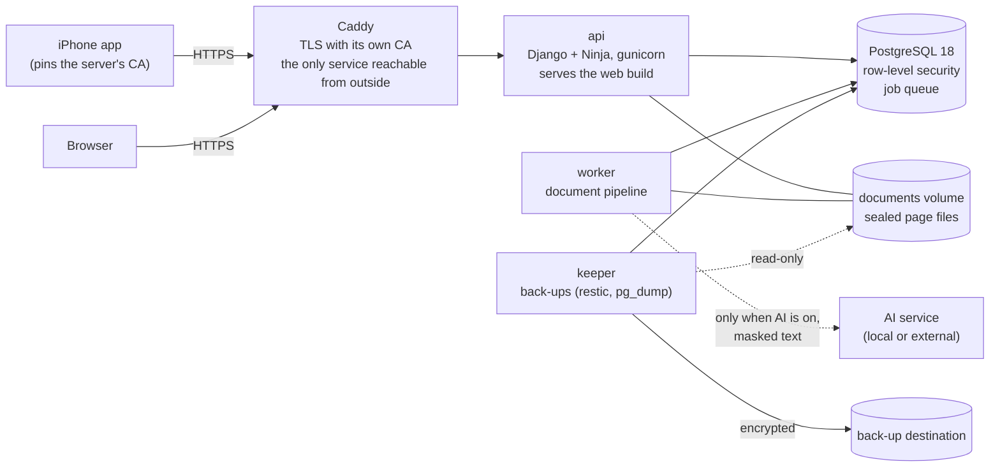

# Brievie host

[](https://github.com/stijnvandepol/Brievie_host/actions/workflows/ci.yml)
[](https://github.com/stijnvandepol/Brievie_host/actions/workflows/codeql.yml)
[](LICENSE)

Brievie keeps, explains and tracks paper post. You scan a letter with the iPhone app;
this server stores it encrypted, works out what it says and what you have to do, and
gives you a task with a deadline once you have confirmed it. It runs on your own machine
(a Mac, a Linux box or a NAS), so your letters stay with you.

It is made for **households** (and the people who help them with their post) and for
**small offices**. Everything happens on a server you run yourself; an AI service is
only used when you switch it on and agree to what leaves the server.

This repository is the server and its web interface. The iOS app is
[`Brievie_ios`](https://github.com/stijnvandepol/Brievie_ios). More at
[brievie.com](https://brievie.com).

**Status:** in development, no release yet. You run it from the `main` branch. See
[Project status](#project-status-and-roadmap) for what is not there yet.

## Install in short

You need Docker with Compose v2 and git, on macOS or Linux. Ports 80 and 443 must be
free.

```sh
git clone https://github.com/stijnvandepol/Brievie_host.git
cd Brievie_host
BRIEVIE_HOSTNAME=mijnmac.local ./brievie start
```

`BRIEVIE_HOSTNAME` is the name or fixed IP address your phone reaches this computer by on
the home network (`mijnmac.local`, `192.168.1.20`). Without it the server is called
`localhost`: that works in a browser on this computer only, and no phone can ever pair
with it (`./brievie start` says so). The first start creates `deploy/.env` with random
secrets, builds the image, starts everything and writes a recovery sheet
(`brievie-herstelblad.html`) that holds the master key: print it, keep it off this
machine, and remove the file. Then open the address it prints and follow
[First set-up](#first-set-up). The details, including the
phone and back-ups, are under [Installation](#installation).

## What it does today

- **Post in, from the phone.** The app scans the pages and recognises the text on the
  phone; the server stores the page images sealed and processes the text in the
  background.
- **Explanation and tasks.** With AI on, the server asks the AI service what the letter is
  about, checks every answer against the letter text (a deadline must be quoted from
  it), and offers the result for review. Nothing becomes a task until a person confirms
  it. With AI off you fill in the review yourself.
- **Ordering.** Post is addressed to persons (with name variants), carries labels and
  can be ordered by rules. A new workspace starts with a set of labels and rules for
  *Thuis* (home) or *Organisatie* (business). A rule builder with a test run, suggestions you
  accept or dismiss, a history per document with undo.
- **Several people, several workspaces.** One server holds separate workspaces. Members
  are invited by link and have a role: admin, member or read-only (*alleen lezen*). Who
  sees which letter follows the workspace's settings (*Wie ziet wat*): at home everyone
  sees all post; in an organisation everyone sees their own post and that of their
  departments; any letter can be made private. Sessions and
  paired phones are listed and can be ended or revoked. An audit log per workspace and
  per server, with CSV export. A member can download their own export where the
  workspace allows it (on by default for *Thuis*).
- **Web interface** (Dutch) for set-up, the inbox, persons, labels, rules
  (*Automatisering*), tasks, members, AI settings, the log and pairing a phone.
- **Back-up and restore** to an external disk, a NAS share, a restic REST server or
  S3-compatible storage, encrypted, with a printed recovery sheet.

## Architecture



One Docker Compose stack (`deploy/docker-compose.yml`). All backend containers run the
same image (`deploy/Dockerfile`): `api` serves the API under `/api/v1` and the built web
app, `worker` runs the background jobs, `keeper` makes back-ups, a one-shot `migrate`
applies migrations, and an `admin` container is started only by `./brievie` for set-up
and restore. Background jobs use [Procrastinate](https://procrastinate.readthedocs.io/)
on PostgreSQL; there is no Redis or Celery. The web interface (`web/`, React and
TypeScript) is built into the image; no Node runs in the stack. The API contract with
the app is `docs/api/openapi.json`. The full design is in `docs/SPEC.md` (Dutch) and
the choices in `docs/DECISIONS.md`.

## Security and privacy

What is stored where and what leaves the server is described in
[docs/PRIVACY.md](docs/PRIVACY.md). In short:

- **Workspaces are separated in the database.** Every workspace table has row-level
  security, enabled and forced. The application connects as a role that cannot bypass
  it; a separate owner role runs migrations, and the `api` container never receives its
  password. The test suite runs as a role that row-level security applies to.
- **Document files are sealed.** Page images are encrypted (AES-256-GCM) with a key per
  workspace, which is itself wrapped with `BRIEVIE_MASTER_KEY`. An AI API key is
  encrypted with the workspace key and never returned by the API.
- **BSNs are masked** (`[BSN]`) before text is stored, logged or sent to an AI service.
- **AI is off by default.** Switching on an external service asks an admin to agree to a
  notice that says what leaves the server and where to; the decision is recorded (who,
  when, which address) and every member sees that AI is on. Only masked text and the
  names of the workspace's labels and persons are sent, never page images.
- **Accounts:** passwords, tokens and links are stored as hashes; sign-in is locked
  after five failures for fifteen minutes; web sessions and phones expire when unused.
- **Transport:** Caddy serves HTTPS with its own certificate authority. The pairing QR
  code carries that authority's fingerprint, and the app trusts only that authority.
- **Back-ups** are encrypted by restic. The master key is never in a back-up; keep the
  recovery sheet safe, and with a REST or S3 destination also its user name and password
  (they are not on the sheet).
- **Honest limits:** recognised text, summaries and names in the database are not
  encrypted (put the database volume on an encrypted disk); whoever runs the server can
  read the database and the log. See "Honest limits" in `docs/PRIVACY.md`.

Found a vulnerability? See [SECURITY.md](SECURITY.md); please do not open a public issue.

## Installation

**With only a compose file** (Portainer, Synology Container Manager, Dockge, Unraid, or
`docker compose up -d`; no checkout, no script): see
[docs/SELFHOST.md](docs/SELFHOST.md) section 24. The file is `deploy/compose/docker-compose.yml`,
attached to every release. The rest of this section is the `./brievie` way (a git checkout).

**Away from home** (VPN, Cloudflare Tunnel or your own reverse proxy): see
[docs/SELFHOST.md](docs/SELFHOST.md) section 25, "Van buiten bereikbaar".

### Start

```sh
./brievie start
```

`./brievie start` creates or completes `deploy/.env` (it never overwrites values you set),
builds the image when needed, starts the stack and waits until it is healthy. Run it
again after changing `deploy/.env` or after `git pull`; it also brings an older
installation up to date. `./brievie help` lists every command.

### First set-up

The address `./brievie start` prints (`https://<BRIEVIE_HOSTNAME>`) shows a certificate
warning: that is expected, see below. The first person to set up the server becomes its
administrator, so set-up asks for an installation code. The `api` container prints it
once in its log:

```sh
docker compose --project-directory deploy -f deploy/docker-compose.yml logs api | grep Installatiecode
```

Or set your own code as `BRIEVIE_SETUP_TOKEN` in `deploy/.env` before the first start.
Lost it? `docker compose --project-directory deploy -f deploy/docker-compose.yml exec api python manage.py prepare_setup_token --new`
prints a new one. The code is deleted after set-up.

### Pairing the iPhone

The phone must reach the server, so `BRIEVIE_HOSTNAME` in `deploy/.env` must be a name or
IP address on your network, not `localhost`. For example the fixed address of the
computer (`BRIEVIE_HOSTNAME=192.168.1.20`) or a local name (`brievie.local`). Give the
computer a fixed address in your router, then run `./brievie start` again.

With the phone on the same Wi-Fi, open **Apparaten** in the web interface, choose
**Koppelcode maken** and scan the QR code with the app. Pairing from a link is in
[docs/SELFHOST.md](docs/SELFHOST.md) section 13.

**The private certificate.** A home server has no public name a public certificate
authority could vouch for, so Caddy makes its own authority and signs the server
certificate with it. Your browser warns about it. The QR code carries the authority's
fingerprint and the app only talks to a server whose certificate chains to exactly that
authority. Nothing has to be installed on the phone.

### AI

A new workspace has AI **off**. An administrator switches it on under **AI** in the web
interface: choose a service, paste the API key and agree to the notice. From a terminal:

```sh
docker compose --project-directory deploy -f deploy/docker-compose.yml exec api \
  python manage.py configure_ai --workspace <workspace-id> --mode external [--supplier mistral|openai|claude]
```

The default supplier is Mistral (Paris). Any OpenAI-compatible service works with
`--base-url` and `--model`; `--mode local --base-url http://<host>:11434/v1 --model <name>`
uses a model on your own network (for example Ollama), and `--mode off` switches AI off.
Every change of decision is recorded.

## Back-up and restore

```sh
# deploy/.env: BRIEVIE_BACKUP_DIR=/path/to/an/external/disk
./brievie backup --init    # once
./brievie backup           # make a back-up
./brievie status           # how the back-ups are doing
./brievie restore          # on a new, empty installation: asks for the source and the master key
```

A back-up holds the database, the sealed document files, the server's certificate
authority (so phones stay paired) and an encrypted copy of `deploy/.env`. It does not
hold the master key: without the recovery sheet nobody can open it, including the makers
of Brievie. There is no nightly schedule yet: run `./brievie backup` yourself or from your
NAS's task scheduler. Destinations, restoring over a running server, what has not been
verified yet and advice for organisations are in [docs/SELFHOST.md](docs/SELFHOST.md).

## Updating

```sh
./brievie update          # to the newest version (asks you to type BIJWERKEN)
./brievie update 0.3.0    # to that version
```

Versions are tags `vX.Y.Z`; what changed is in [CHANGELOG.md](CHANGELOG.md), with
**Voor je bijwerkt** first when a release asks something of you. The update checks the
jump, builds the new version while Brievie runs, stops it, backs up (to your
destination, or an emergency copy on this machine), then updates the database and starts
the new version. If that fails it prints the way back: `git checkout` of the old version
and `./brievie restore pre-update-<version>`. Nothing updates by itself. An installation
from before versions moves once by hand (`git fetch --tags`, `git checkout v0.2.0`,
`./brievie start`). Details: [docs/SELFHOST.md](docs/SELFHOST.md), section 21.

## Development

Requirements: Docker with Compose v2, [uv](https://docs.astral.sh/uv/) (installs Python
3.13), Node 24+ and pnpm for the web interface.

```sh
make dev           # deploy/.env with random secrets, PostgreSQL 18 on 127.0.0.1:5432
make migrate       # apply migrations as the owner role
make test          # pytest
make lint          # ruff check + ruff format --check
make typecheck     # mypy --strict
make openapi       # write docs/api/openapi.json
make web-install   # then: cd web && pnpm dev (proxies /api to the running stack)
make web-test web-lint web-build
make web-api       # regenerate the web's API types after make openapi
make web-i18n      # update the Dutch text catalogue after changing visible text
```

[CONTRIBUTING.md](CONTRIBUTING.md) has the rules a change is reviewed against and how to
open a pull request.

## Testing and CI

Every pull request and every push to `main` runs `.github/workflows/ci.yml`:

- **backend:** ruff (with the flake8-bandit security rules), `mypy --strict`, migration
  and OpenAPI drift checks, pytest with coverage against PostgreSQL 18, pip-audit.
- **web:** Biome, `tsc`, API-type and text-catalogue drift checks, Vitest with
  coverage, production build, `pnpm audit`.
- **secrets:** gitleaks on the pushed commits.
- **workflows:** zizmor on the GitHub Actions workflows.
- **image:** hadolint on the Dockerfile, then Trivy on the built image.
- **stack:** starts the whole stack with fresh secrets and checks the API through Caddy,
  the web interface, the worker, the keeper and the installation code.
- **dast:** OWASP ZAP against that stack: a baseline scan of the web interface and an
  active scan of the API from the OpenAPI contract.
- **restore:** makes a server, seeds it, backs it up, destroys it and restores it twice,
  then checks every page against the old certificate authority.

`.github/workflows/codeql.yml` runs CodeQL on Python, TypeScript and the workflows. The
dependency audits, gitleaks, zizmor, the image scan, ZAP and CodeQL also run every
Monday, Wednesday and Friday on `main`; a failure opens an issue (see `SECURITY.md`). Dependabot proposes updates for actions, Python, npm and Docker images weekly.
Every third-party action is pinned to a commit.

## Project status and roadmap

Built (phases 1a to 1d part A in `docs/SPEC.md`): the foundation (workspaces, row-level
security, sign-in, pairing, the private CA), the document pipeline with optional AI and
recorded consent, ordering (persons, labels, rules, tasks), members, roles, devices and
the audit log, and back-up and restore.

Not there yet:

- releases and published images (you build from source);
- per-member private post, a second factor and single sign-on (SSO);
- reaching the server from outside your own network (the phone must be on the same
  network);
- a nightly back-up schedule;
- search, and post that comes in other than through the app (watch folder, e-mail);
  Brievie sends no e-mail;
- the business features of phase 2 (invoice fields, UBL, VAT overview).

The stack and a full back-up and restore run in CI on GitHub's Linux runners; restore was
also tested by hand on a Mac with Docker Desktop. Not yet tested on a Synology or other
NAS. The roadmap is section 16 of `docs/SPEC.md`.

## Licence

Brievie host is free software: you can redistribute it and/or modify it under the terms of
the GNU Affero General Public License as published by the Free Software Foundation, either
version 3 of the License, or (at your option) any later version. It comes without any
warranty. The full text is in `LICENSE`.

If you run a modified version as a service for others, the AGPL requires you to offer
those users the source of your version.

## Contact

Security reports: [SECURITY.md](SECURITY.md) (info@brievie.com). Everything else: an issue
in this repository, or [brievie.com](https://brievie.com).
